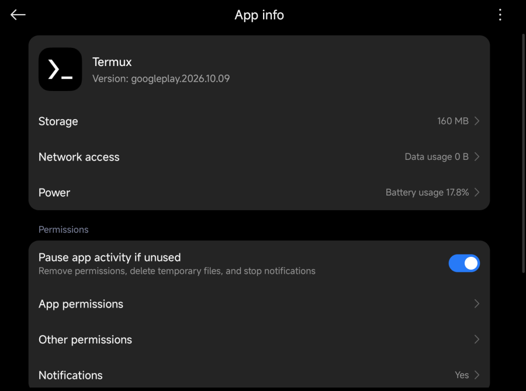
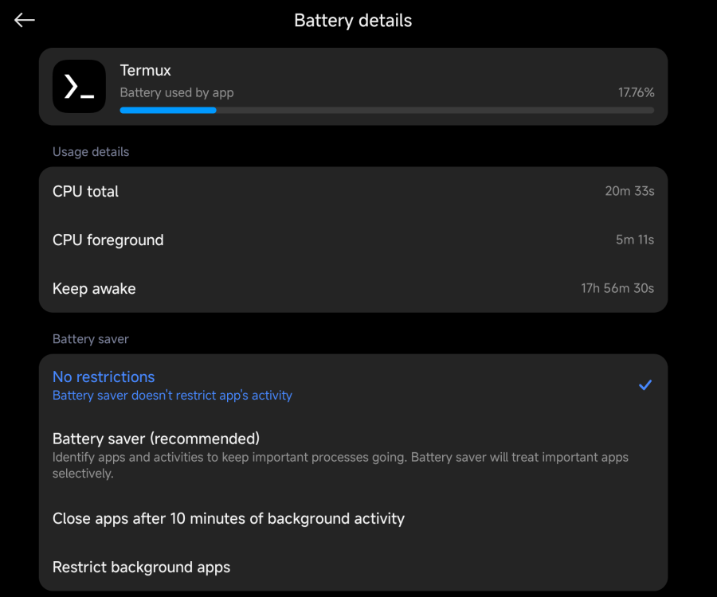
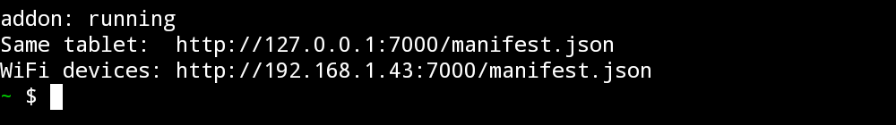
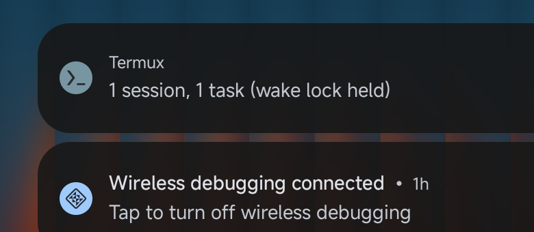
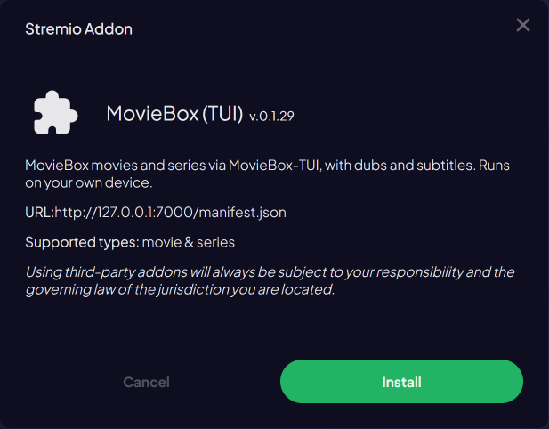
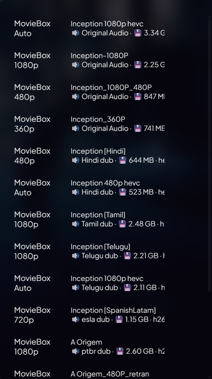

# MovieBox → Stremio: Android par setup (10 steps)

Ye guide ek Android phone/tablet par MovieBox addon chalati hai, taaki ghar ke WiFi par
Stremio mein MovieBox ki movies aur series dekh sakein. Server isi device par chalta hai.
Cloudflare ya koi paid server nahi chahiye.

---

## Step 1: Termux install karein

Play Store se **Termux** install karein. Bas yahi ek app chahiye.

> Play Store aur F-Droid wale Termux ko **mix na karein**.

## Step 2: Termux ek baar kholein

## Step 3: Termux ko background mein chalne dein

Settings → Apps → **Termux** kholein:

1. **Pause app activity if unused** → **OFF** karein.
2. **Power / Battery** → **No restrictions (Unrestricted)** chunein.
3. Xiaomi/Redmi device ho to **Autostart** bhi **ON** karein.





## Step 4: curl install karein

Termux mein ye command chalayein:

```
pkg update -y && pkg install -y curl
```

## Step 5: Storage permission dein

```
termux-setup-storage
```

Popup aaye to **Allow** dabayein.

## Step 6: Addon download karein

Poori line copy karke paste karein. Ye device ke hisaab se sahi file khud chun leti hai:

```
A=arm64; [ "$(uname -m)" = aarch64 ] || A=armv7; curl -fL https://github.com/8307788179sS/MovieBox-Tui/releases/download/stremio-addon/moviebox-stremio-android-$A -o $PREFIX/bin/moviebox-stremio && chmod +x $PREFIX/bin/moviebox-stremio
```

Check karne ke liye `moviebox-stremio --help` chalayein. `moviebox-stremio [--port 7000] ...` dikhe to sahi hai.

## Step 7: `mbx` script download karein

```
curl -fL https://raw.githubusercontent.com/8307788179sS/MovieBox-Tui/main/scripts/termux/mbx -o $PREFIX/bin/mbx && chmod +x $PREFIX/bin/mbx
```

## Step 8: Restart par auto-start

```
mkdir -p ~/.termux/boot && curl -fL https://raw.githubusercontent.com/8307788179sS/MovieBox-Tui/main/scripts/termux/boot-start -o ~/.termux/boot/start && chmod +x ~/.termux/boot/start
```

## Step 9: Addon chalu karein

```
mbx start
```

Ye 2 link dikhayega (aapka IP alag ho sakta hai):



- **Same tablet** wala link usi device ke Stremio ke liye hai.
- **WiFi devices** wala link usi WiFi par dusre phone/TV ke liye hai.

Addon chal raha ho to Termux ki notification mein **wake lock held** dikhega:



## Step 10: Stremio mein addon add karein

Stremio → **Addons** → **Add addon** → link paste karein → **Install**.



Movie ya series kholein, **MovieBox** wali stream chunein, aur video chalegi.



---

## Roz kaam aane wale commands (Termux mein)

| Command | Kaam |
|---|---|
| `mbx status` | addon chal raha hai ya nahi, aur link |
| `mbx start` | band ho to chalu karein |
| `mbx link` | link dobara dekhein (IP badalne par naya link yahin milega) |
| `mbx update` | addon ka naya version |

## Dhyan rahe

- Device ko **charger par** rakhein.
- Termux ki notification mein **Exit** na dabayein, aur recent apps se Termux band na karein.
- Router device ko naya IP de de to **WiFi devices** wala link badal jaata hai. Naya link `mbx link` se milega.
- **Laptop** ka Stremio (app ya browser) `192.168.x.x` jaisa `http://` link **block karta hai**. Laptop ke liye alag forward setup chahiye.
- Browser mein **h264** stream chunein. Phone/TV ke Stremio app mein hevc bhi chal sakti hai.

## Problem aaye to

| Problem | Hal |
|---|---|
| Stremio mein "Failed to fetch" / "No streams were found" | Termux mein `mbx status` chalayein. `NOT running` aaye to `mbx start`. Running ho to `mbx link` se naya link lekar Stremio mein dobara add karein. |
| Restart ke baad addon nahi chala | Termux ek baar kholein, ya `mbx start` chalayein. Autostart ON hai, ye check karein. |
| Screen band hone par addon ruk jaata hai | Step 3 dobara check karein: battery **No restrictions** honi chahiye. |
| Browser mein video nahi chalti | **hevc** ki jagah **h264** wali stream chunein. |
